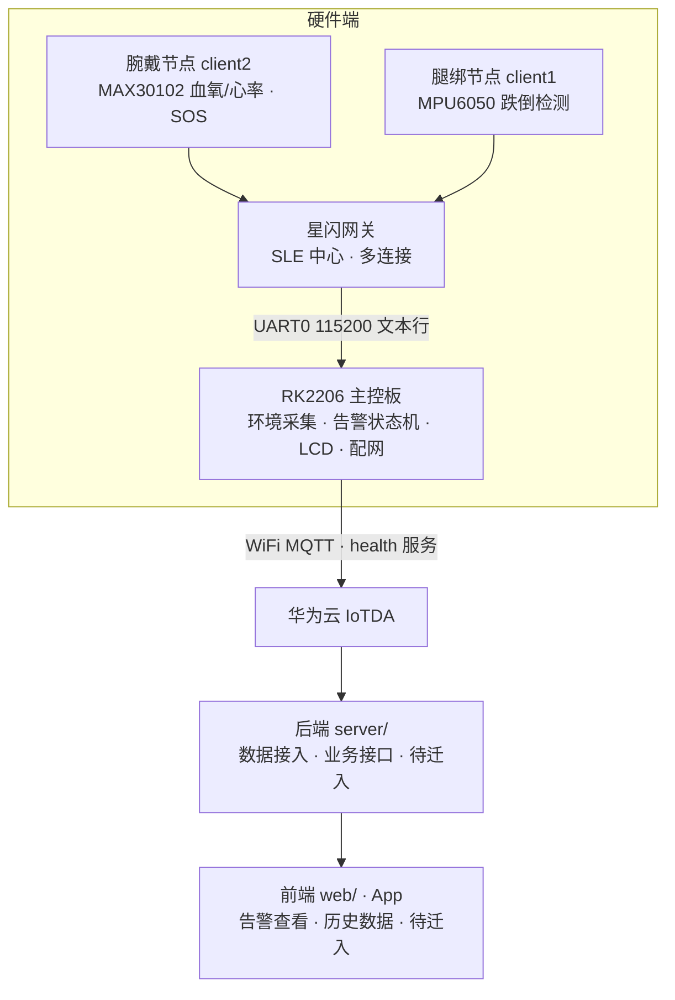

# 守望·星护居 —— 智慧养老监护系统

> 基于 RK2206（OpenHarmony 3.0 LTS · LiteOS-M）的独居老人智慧养老监护终端。
> 板载环境安全传感器 + 星闪（SLE）穿戴健康节点 + 本地声光告警 + LCD 中文界面 + 华为云 IoTDA 实时上云。

## 一、项目简介

面向养老院 / 居家养老场景，系统通过板载环境传感器与星闪穿戴节点实时采集老人体征、姿态与居家环境状态；在跌倒、SOS 呼救、可燃气体等事件发生时，由主控本地声光告警，并经云端链路上报监护方，形成「终端采集 → 星闪汇聚 → 主控判定 → 云端上报 → 告警处置」的流程。

### 核心能力

| 模块 | 功能 |
|---|---|
| 环境安全监测 | PIR 人体感应 · MQ2 可燃气体 · SHT30 温湿度 · 门磁 · 火焰传感器 |
| 星闪健康节点 | 腿绑 MPU6050（跌倒检测）· 腕戴 MAX30102（血氧/心率）· SOS 一键呼救，经星闪网关接入 UART0 |
| 本地告警 | 蜂鸣器 · RGB 灯 · 震动电机，统一报警状态机 |
| 人机交互 | LCD ST7789V 中文实时界面 · K3~K6 按键 |
| 配网 | NFC 碰一碰配网 · AP 模式 Web 页面 WiFi 配网 |
| 华为云 IoTDA | MQTT 属性上报（`health` 服务）· 血氧/心率/跌倒/SOS/环境数据上云 |

### 角色

- **老人**：佩戴腕戴 / 腿绑节点，触发 SOS 呼救与体征、姿态上报。
- **家属 / 监护人**：接收告警、查看体征与历史数据（云端 / App 链路待迁入）。
- **护理员 / 管理员**：设备管理、告警处置记录与规则配置（后端待迁入）。

## 二、系统架构



### 数据主链路

1. 腕戴 / 腿绑节点采集血氧、心率、加速度与 SOS 状态，经星闪（SLE）发给网关；
2. 网关多连接接收各节点数据，按文本行经 UART0（115200 8N1）转发 RK2206 主控；
3. 主控汇总环境传感器与节点数据，由本地报警状态机判定，驱动蜂鸣器 / RGB / 震动并刷新 LCD；
4. 主控经 WiFi 通过 MQTT 将 `health` 服务属性批量上报华为云 IoTDA；
5. 后端 `server/` 接入 IoTDA 数据并对外提供业务接口（待迁入）；
6. 前端 `web/` 与移动端查询历史、接收告警推送（待迁入）。

## 三、技术栈

| 模块 | 技术 / 说明 |
|---|---|
| 主控板固件 | C，OpenHarmony 3.0 LTS（LiteOS-M / RK2206）；传感器驱动、告警状态机、LCD UI、配网、MQTT 上云 |
| 星闪节点 / 网关固件 | C，Hi3863 BearPi Pico；SLE 星闪组网、MAX30102 PPG 采集、MPU6050 姿态采集、低功耗 |
| 上云接入 | 华为云 IoTDA，MQTT 属性上报（`health` 服务），设备三元组鉴权 |
| 后端服务 | 待迁入（`server/`，技术栈待定） |
| 前端 / App | 待迁入（`web/`，可视化大屏 / H5 / 移动端，技术栈待定） |
| 构建与烧录 | GN / Ninja + `hb` 构建，`flash.py` 串口烧录，`package_fw.sh` 打包固件镜像 |
| 通信协议 | 星闪 UART 文本行 + MQTT 属性模型（属性名见 `cloud_properties.h`） |

## 硬件平台

- 开发板：通晓 TX-SMART-R（RK2206），引脚定义见 [`vendor/lockzhiner/rk2206/samples/z_elderly_care/include/board_pins.h`](vendor/lockzhiner/rk2206/samples/z_elderly_care/include/board_pins.h)
- 外接：MPU6050 + MAX30102 + SOS 按键（星闪节点）、门磁、火焰传感器
- 显示：ST7789V SPI LCD（SPI0_M1）

## 四、仓库结构

本仓库为 OpenHarmony 3.0 LTS 基线大仓，`vendor/lockzhiner/` 下为本项目板级适配与应用代码。

```
Elderly-Monitoring-System/
├── applications/            # OpenHarmony 应用样例（基线）
│   ├── sample/              # camera、wifi-iot 等官方样例
│   └── standard/            # 标准系统应用（基线）
├── base/                    # OpenHarmony 基础系统组件（基线源码备份）
├── build/                   # 构建系统（GN / Ninja 脚本）
├── device/
│   └── rockchip/            # RK2206 板级适配与烧录工具
├── docs/                    # 全局文档：架构、协议、部署记录
├── domains/
│   └── iot/link/            # 物联网领域链路组件（基线）
├── drivers/                 # 内核 / 外设驱动（基线）
├── firmware/                # ★ 编译产物固件镜像（不参与编译）
│   ├── 主控板固件/          # Firmware.img / Firmware.md5 / rk2206_db_loader.bin
│   └── 星闪固件/            # gateway / client1 / client2 的 *.fwpkg
├── foundation/              # OpenHarmony 基础库（基线源码备份）
├── interface/
│   └── sdk-js/              # JS 接口声明（基线）
├── kernel/                  # LiteOS-M 内核（基线源码备份）
├── prebuilts/               # 预编译工具链 / 二进制（基线）
├── productdefine/
│   └── common/              # 产品配置定义（基线）
├── server/                  # ★ 后端服务：设备接入 / 业务接口（待迁入）
├── test/                    # 测试框架：developertest / xdevice / xts
├── third_party/             # 第三方开源依赖（基线）
├── tools/                   # 仓库级工具：字模生成 gen_font.py / gen_font_lcdh.py
├── utils/                   # 原生工具库 / NDK 配置（基线）
├── vendor/
│   └── lockzhiner/
│       └── rk2206/          # ★ 板级适配与本项目应用
│           ├── samples/
│           │   ├── z_elderly_care/   # 本项目主程序（传感器/告警/UI/配网/上云）
│           │   └── b23_iot_lcd/      # ST7789V LCD 驱动依赖
│           ├── hals/ hdf_config/ hdf_drivers/ image/ images/
│           └── BUILD.gn / config.json
├── web/                     # ★ 前端：可视化大屏 / H5（待迁入）
├── .gitignore               # 构建产物、依赖目录、凭据忽略规则
├── build.py / build.sh      # 一键构建脚本
├── flash.py                 # 串口烧录脚本
├── package_fw.sh            # 固件打包脚本
├── LICENSE                  # Apache-2.0
├── README_zh.md             # 中文说明（基线自带）
└── README.md                # 本文件
```

### 项目主程序内部结构

主程序位于 `vendor/lockzhiner/rk2206/samples/z_elderly_care/`：

```
z_elderly_care/
├── src/
│   ├── elderly_care_example.c   # 主程序（任务调度、按键、UI 刷新）
│   ├── sensors.c                # PIR / MQ2 / SHT30 / 门磁 / 火焰
│   ├── mpu_uart.c               # 星闪网关 UART 协议（MPU6050/MAX30102/SOS）
│   ├── alert.c                  # 声光/电机告警状态机
│   ├── lcd_ui.c                 # LCD 中文界面
│   ├── wifi_provision.c         # AP 模式 Web 配网
│   ├── nfc_provision.c          # NFC 碰一碰配网（NT3H）
│   ├── cloud_mqtt.c             # 华为云 IoTDA 上报（三元组在此配置）
│   └── oc_mqtt*.c               # oc_mqtt 移植层
└── include/
    ├── board_pins.h             # 板级引脚定义
    └── cloud_properties.h       # 华为云产品模型（服务/属性名）
```

## 五、模块导航

| 路径 | 说明 | 当前状态 |
|---|---|---|
| [`vendor/lockzhiner/rk2206/samples/z_elderly_care/`](vendor/lockzhiner/rk2206/samples/z_elderly_care/) | 主控主程序：传感器 / 告警 / UI / 配网 / 上云 | ✅ 已迁入 |
| [`firmware/`](firmware/) | 固件镜像：主控 `Firmware.img`、星闪网关与节点 `.fwpkg` | ✅ 已迁入 |
| [`web/`](web/) | 前端可视化大屏 / H5 | 骨架，待迁入 |
| [`server/`](server/) | 后端设备接入 / 业务接口 | 骨架，待迁入 |
| [`docs/`](docs/) | 全局文档（架构、协议、部署记录） | 待补充 |

## 六、端云协议（摘要）

服务与属性名以 [`cloud_properties.h`](vendor/lockzhiner/rk2206/samples/z_elderly_care/include/cloud_properties.h) 为准；修改上报字段必须同步华为云 IoTDA 产品模型。

| Topic / 链路 | 方向 | 说明 |
|---|---|---|
| `$oc/devices/{device_id}/sys/properties/report` | 设备 → 云 | `health` 服务属性批量上报：血氧 / 心率 / SOS / 跌倒 / 体温 / IMU / 环境 / 安全状态 |
| `[SPO2]{json}` | 腕戴节点 → 网关 → 主控 | 血氧 / 心率 / SOS，UART0 文本行 |
| `[MPU]{json}` | 腿绑节点 → 网关 → 主控 | 加速度 / 陀螺仪 / 跌倒标志，UART0 文本行 |
| HTTP 配网（主控 AP `192.168.2.10`） | 主控 ↔ 配网终端 | AP 模式下 WiFi 账号密码查询与下发 |

> 现有固件沿用上述上报格式；调整 topic 或属性名会破坏与 IoTDA 产品模型的兼容性，需先改产品模型再改固件。

## 开发环境

- Ubuntu 22.04（WSL2 / Docker / 原生均可）
- Python 3、GN/Ninja、`hb` 构建工具（OpenHarmony 标准）
- 环境搭建详细步骤见 [`vendor/lockzhiner/rk2206/README_zh.md`](vendor/lockzhiner/rk2206/README_zh.md)

## 编译

```shell
hb set -root .
hb set
# 选择 lockzhiner → lockzhiner-rk2206
hb build -f
```

编译产物（固件镜像）位于 `out/rk2206/lockzhiner-rk2206/images/`。

## 打包固件（可选）

`package_fw.sh` 可手动打包完整固件镜像（自动从 `sdk_liteos/include/link.h` 解析分区表，行为与官方 `mkimage.sh` 一致）：

```shell
./package_fw.sh
```

## 烧录

```shell
cd device/rockchip/tools/linux
sudo python3 flash.py
```

## 华为云 IoTDA 配置

1. 在华为云 IoTDA 控制台创建产品，按 [`cloud_properties.h`](vendor/lockzhiner/rk2206/samples/z_elderly_care/include/cloud_properties.h) 定义服务/属性模型（服务 ID：`health`）
2. 创建设备，获取 MQTT 接入三元组（ClientID / Username / Password）
3. 填入 [`src/cloud_mqtt.c`](vendor/lockzhiner/rk2206/samples/z_elderly_care/src/cloud_mqtt.c) 顶部的 `CLOUD_CLIENT_ID` / `CLOUD_USERNAME` / `CLOUD_PASSWORD`

> 仓库中三元组为占位符，请替换为你自己设备的凭据后再编译烧录。

## 致谢

- 本项目基于 [福州凌智电子 lockzhiner-rk2206-openharmony3.0lts](https://gitee.com/Lockzhiner-Electronics/lockzhiner-rk2206-openharmony3.0lts)（OpenHarmony 3.0 LTS）修改构建，遵循 Apache License 2.0
- 板级引脚定义参考通晓 TX-SMART-R 官方仓库（isoh_edu/txsmartropenharmony）

## License

Apache License 2.0，详见 [LICENSE](LICENSE)。
